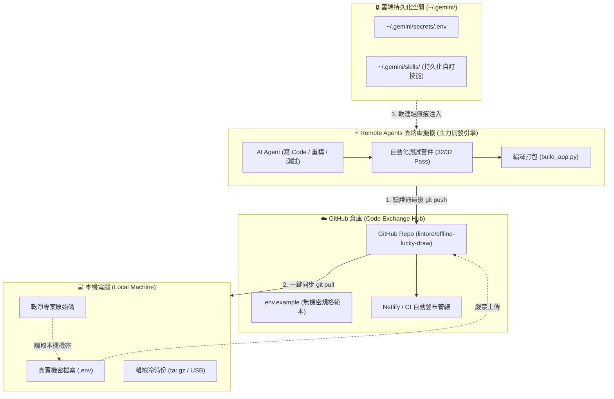

# 三層式雲端 AI 協作開發與機密隔離架構企劃書
## 暨專案交接 SOP 與自訂 Skill 安裝維護指南

> **專案代號**：Cloud-Native 3-Tier AI Dev Architecture & Offline Lucky Draw Handover  
> **版本**：v1.0.0  
> **建立日期**：2026 年 11 月 7 日  
> **範例專案**：純前端單檔離線抽獎大會系統 (`lintoro/offline-lucky-draw`)  

---

## 目錄 (Table of Contents)

1. [執行摘要與架構願景 (Executive Summary)](#1-執行摘要與架構願景-executive-summary)
2. [三層生態系架構與職責矩陣 (The 3-Tier Architecture)](#2-三層生態系架構與職責矩陣-the-3-tier-architecture)
3. [機密隔離與雲端持久化落地實施 (Secret Isolation & Persistence)](#3-機密隔離與雲端持久化落地實施-secret-isolation--persistence)
4. [實證示範案例：純前端單檔離線抽獎大會系統](#4-實證示範案例純前端單檔離線抽獎大會系統)
5. [自訂 Skill 安裝、交接與跨 VM 永久保留指南](#5-自訂-skill-安裝交接與跨-vm-永久保留指南)
6. [標準開發閉環與交接檢核表 (Daily Workflow & Handover Checklist)](#6-標準開發閉環與交接檢核表-daily-workflow--handover-checklist)

---

## 1. 執行摘要與架構願景 (Executive Summary)

### 1.1 痛點背景
在傳統軟體開發與新一代「雲端 AI 代理（Remote Agents / VM）」協同開發的過渡期中，開發者常面臨三大核心矛盾：
1. **機密資料外洩風險**：專案中的 `.env`、API Key、私人金鑰常因疏忽隨代碼推送到公開或私人 GitHub 倉庫，造成重大資安事故或帳單被盜刷。
2. **本機環境臃腫與依賴地獄**：本機電腦必須安裝各種龐大的編譯工具鏈（Node.js、Python、Rust、Docker），且換電腦或重灌時需要重新配置半天。
3. **雲端 VM 的暫態性（Ephemeral）遺失問題**：雲端 Remote Agents 雖然運算強大、敏捷高效，但每次任務重新配發虛擬機時，磁碟會被還原，自訂的工具、配置與環境容易丟失。

### 1.2 核心架構理念
本企劃書提出 **「三位一體・分工制衡」** 的現代化架構體系：
- **本機電腦（Local PC）**：作為 **「實體保險箱與最終備份」**，保管真實 `.env`，不承擔繁重複雜的重型編譯。
- **GitHub 倉庫（GitHub Repo）**：作為 **「純淨代碼交換中心」**，絕對隔離一切機密，僅流通純源碼與自動化管線配置。
- **雲端虛擬機（Remote Agents VM）**：作為 **「敏捷主力開發引擎」**，由 AI 代理執行高強度編程、代碼重構、自動化測試與打包，並透過雲端持久層讀取私密變數。

---

## 2. 三層生態系架構與職責矩陣 (The 3-Tier Architecture)

### 2.1 系統架構流轉圖



### 2.2 三層職責分工矩陣

| 維度 | 💻 本機電腦 (Local PC) | ☁️ GitHub 倉庫 (Git Hub) | ⚡ Remote Agents VM (雲端主力) |
| :--- | :--- | :--- | :--- |
| **主要定位** | 機密保險箱、冷備份、最終體驗端 | 代碼中轉站、版本歷史、CI/CD 觸發 | 主力開發工場、重型運算、測試驗證 |
| **存放內容** | 完整專案 + 真實 `.env` + 備份封存 | 純淨原始碼 + `.env.example` + `.gitignore` | 檢出之工作目錄 + 依賴套件 + 生成產物 |
| **安全性策略** | 物理硬碟隔離、防毒軟體防護 | 嚴格防呆忽略規則、零 Token/Key | 砂箱環境隔離、非特權使用者執行 |
| **日常操作** | 僅需輸入 `git pull` 取得最新進度 | 接收來自雲端的自動化 Push | AI 全自動讀寫、除錯、打包、跑測試 |
| **災難復原** | 擁有最完整可運行的終端複本 | 雲端歷史隨時可還原至任一 Commit | 隨開隨用，主機毀損 1 秒重建 |

---

## 3. 機密隔離與雲端持久化落地實施 (Secret Isolation & Persistence)

### 3.1 雙層防呆防護網（GitHub 零機密）
為徹底杜絕 `.env` 意外上傳，專案根目錄必須落實以下標準配置：

#### 1. `.gitignore` 終極隔離規範
```gitignore
# 嚴格禁止任何環境變數與金鑰檔案進倉庫
.env
.env.*
!.env.example
*.local
secrets/
```

#### 2. `.env.example` 規格宣告規範
GitHub 上永遠只維護一份「有 Key 無 Value」的範本，清楚定義所有相依變數：
```bash
# ==========================================
# 專案環境變數設定範本 (可公開於 GitHub)
# 請複製本檔案為 .env 並填入真實金鑰
# ==========================================
PORT=8080
APP_ENV=production
# 範例第三方金鑰 (請至官方後台申請)
EXTERNAL_API_KEY=your_api_key_here
```

### 3.2 雲端 VM 的機密注入與持久化解法
Remote VM 重新配發時主機磁碟（如 `/home/antigravity/<repo>`）可能重置，但使用者的 **`~/.gemini` 目錄是永久保留的**。

#### 實作 SOP：
1. **建立私密目錄**：
   在持久化目錄建立金鑰存放區：
   ```bash
   mkdir -p ~/.gemini/secrets
   ```
2. **存放真實環境設定**：
   將真實的環境變數寫入 `~/.gemini/secrets/offline-lucky-draw.env`。
3. **無痕軟連結（Symlink）注入**：
   在專案需要執行或測試時，僅需建立符號連結：
   ```bash
   ln -s ~/.gemini/secrets/offline-lucky-draw.env .env
   ```
4. **安全優勢**：
   - 雲端 VM 具備完整環境變數可直接運行與測試。
   - 因為 `.gitignore` 阻擋了 `.env`，`git commit` 永遠不會捕捉到它。
   - 即使對話結束、VM 重啟，下次載入時 `~/.gemini/secrets/` 依舊完好如初。

---

## 4. 實證示範案例：純前端單檔離線抽獎大會系統

以本專案 **「純前端單檔離線抽獎 Web 應用」** 作為標準驗證案例，展現三層架構之優勢：

### 4.1 專案關鍵約束與挑戰
- **零外部網路依賴**：嚴格 CSP `default-src 'none'; style-src 'unsafe-inline'; script-src 'unsafe-inline';`，嚴禁任何外鏈 CDN 或雲端字型。
- **單檔 HTML 預算上限**：最終打包產物 `index.html` 必須 $\le 65\text{ KB}$ (66,560 bytes)。
- **5 大開獎動態模式**：包含全景開箱滑軌 (CS:GO Ribbon Tape)、氣壓式彩球樂透機、復古拉霸機、翻牌式機械看板、時空跳躍光斑。
- **純前端關閉即焚**：Zero-Persistence 規範，不使用 localStorage / cookies，保護個資隱私。

### 4.2 本案在三層架構中的流轉歷程

```
1. [本機發想] 提出抽獎規格書與公平性限制 (maxWinLimit, 4大主題)
        │
        ▼
2. [雲端 VM 主力開發]
   ├── 撰寫 src/masterVisualEngine.js (CS:GO 滑軌、雷射準心)
   ├── 撰寫 src/stateManager.js (CSPRNG 加密級隨機數、5模式不重複排程)
   ├── 編寫 build_app.py (Terser 壓縮 + HTML 注解修剪 + CSS 優化)
   ├── 自動化測試驗證：node --test tests/*.test.js (32 項全數通過)
   └── 體積嚴格控管：64.00 KB (65,534 bytes <= 65 KB)
        │
        ▼
3. [GitHub 倉庫存檔]
   ├── 提交節點：4826301 (feat: replace wheel with CS:GO ribbon tape)
   ├── 提交節點：12464b8 (ci: add netlify.toml for zero-config hosting)
   └── 嚴格保持純淨，無任何個人機密或多餘除錯標籤
        │
        ▼
4. [匿名無痕發布] Netlify 全自動部署 (https://xxx.netlify.app，零個資外洩)
        │
        ▼
5. [本機一鍵同步] 本機電腦終端機 git pull，即刻獲得完整可離線執行版本
```

---

## 5. 自訂 Skill 安裝、交接與跨 VM 永久保留指南

### 5.1 為什麼需要自訂 Skill？
當您將專案交接給他人、或由新的 Remote Agent 接手時，AI 通常不清楚本專案特殊的編譯規範（例如不能直接手改 `index.html`，必須改 `src/` 並跑 `build_app.py` 驗收體積）。

透過建立一個專屬的 **Skill（技能包）**，任何 Agent 載入後就能「立即學會」專案的所有專屬命令與檢查清單！

### 5.2 Skill 的標準目錄架構
一個標準的 Skill 應包含以下檔案：

```
my-custom-skill/
├── SKILL.md            # 核心指令檔 (含 YAML frontmatter 與詳細操作 SOP)
├── scripts/            # 可執行輔助工具腳本 (bash, python, node)
└── references/         # 補充參考手冊或規格文件
```

### 5.3 示範案例：為本專案打造的 `lucky-draw-ops` Skill

#### 檔案：`SKILL.md`
```markdown
---
name: lucky-draw-ops
description: 純前端離線抽獎專案之專屬運維、建置、打包與測試技能。當需要修改抽獎邏輯、調整動畫模式、編譯 index.html 或執行體積與 CSP 檢驗時使用。
---

# Lucky Draw Operations Skill

本專案為嚴格遵守 65 KB 單檔限制之純前端抽獎應用，請務必遵循以下管線流程：

## 1. 原始碼結構規範
- 狀態機核心：`src/stateManager.js`
- 視覺渲染引擎：`src/masterVisualEngine.js` (含 CS:GO 滑軌等 5 大模式)
- 網頁音效合成：`src/audioSynthesizer.js`
- 慶典紙花粒子：`src/confetti.js`

## 2. 嚴格建置打包指令
嚴禁直接手動編輯 `index.html` 的 JavaScript 代碼！每次修改 `src/` 後，必須執行：
```bash
python3 build_app.py
```
- 建置腳本會自動調用 Terser 壓縮並去除注釋。
- 若體積超過 65 KB (66,560 bytes)，建置會發出警告，必須進行代碼精簡。

## 3. 自動化測試驗證
每次提交前必須運行 32 項全套自動化測試並確保 100% 通過：
```bash
node --test tests/*.test.js
```

## 4. 交付安全規範
- 絕不在此專案提交任何未經使用者明確指示的 Git Commit。
- 絕不引入任何外部 CDN、外部圖片或第三方遠端字型。
```

### 5.4 跨 VM 永久保留安裝方式

在 Remote Agents 環境中，將技能安裝到持久化路徑：
```bash
# 建立持久化技能目錄
mkdir -p ~/.gemini/skills/lucky-draw-ops

# 將撰寫好的 SKILL.md 寫入該目錄
cp SKILL.md ~/.gemini/skills/lucky-draw-ops/SKILL.md
```
**效果**：
- 只要存放在 `~/.gemini/skills/`，未來無論分發到哪一台虛擬機，您的專屬 Skill 都會永久存在。
- Agent 可以主動調用 `lookup_skill` 讀取並嚴格遵循該規範。

---

## 6. 標準開發閉環與交接檢核表 (Daily Workflow & Handover Checklist)

### 6.1 新成員 3 分鐘快速接手 SOP (Onboarding)

```bash
# 1. 本機取得最新乾淨原始碼
git clone https://github.com/lintoro/offline-lucky-draw.git
cd offline-lucky-draw

# 2. 安裝本地測試依賴
npm install

# 3. 執行全套測試驗證環境正常
node --test tests/*.test.js

# 4. 直接打開 index.html 即可離線體驗完整功能！
open index.html # 或在 Windows 直接按兩下 index.html
```

### 6.2 日常敏捷開發 4 步循環 (Daily Loop)

| 步驟 | 負責端 | 執行動作 | 驗收標準 |
| :---: | :---: | :--- | :--- |
| **Step 1** | 使用者 | 在 Remote Agents 對話視窗提出新需求或優化項目 | 需求明確描述 |
| **Step 2** | 雲端 Agent | 在 VM 內撰寫代碼 ➔ 執行 `python3 build_app.py` ➔ 運行測試 | 體積 $\le 65\text{ KB}$、32 項測試 PASS |
| **Step 3** | 雲端 Agent | 執行 `git commit` & `git push origin main` | GitHub 最新存檔點成立，Netlify 自動發布 |
| **Step 4** | 本機電腦 | 本機終端機輸入 `git pull` | 本機複本即時同步，擁有隨身可用最新版 |

### 6.3 專案交付前完整安全檢核清單 (Pre-Flight Checklist)

- [x] **CSP 標頭合規**：包含 `default-src 'none'; style-src 'unsafe-inline'; script-src 'unsafe-inline';`
- [x] **零外部相依性**：無任何 `<link rel="stylesheet">` 或 `<script src="...">` 引用外部網路資源
- [x] **體積嚴格達標**：`index.html` 體積為 64.00 KB（65,534 bytes），小於 65 KB 限制
- [x] **機密完全隔離**：Git 歷史紀錄與工作區不含任何 `.env` 或機密私鑰
- [x] **全套測試通過**：32/32 項單元測試、邊界測試、安全測試與 E2E 模擬測試皆 PASS
- [x] **連續抽獎流暢**：支援「抽取下一位 (Space)」自動連抽與「查看舞台」駐足報獎雙軌互動
- [x] **多種動態模式**：包含 CS:GO 全景滑軌、樂透機、拉霸機、翻牌機、時空跳躍光斑隨機輪播
- [x] **無痕匿名上線**：已於 Netlify 成功部署，具備獨立 HTTPS，不洩漏任何個人帳號個資

---
**本手冊完結・可直接作為專案交付與後續維護依據**
